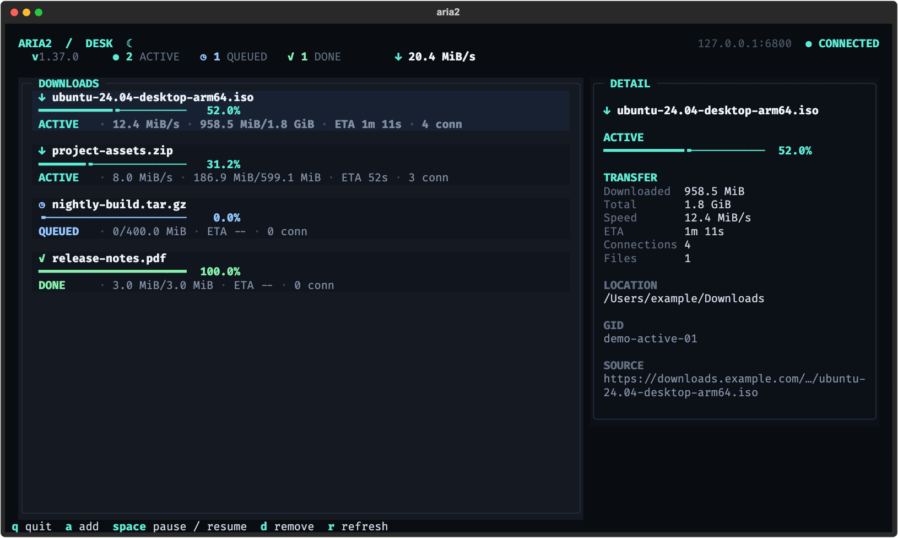
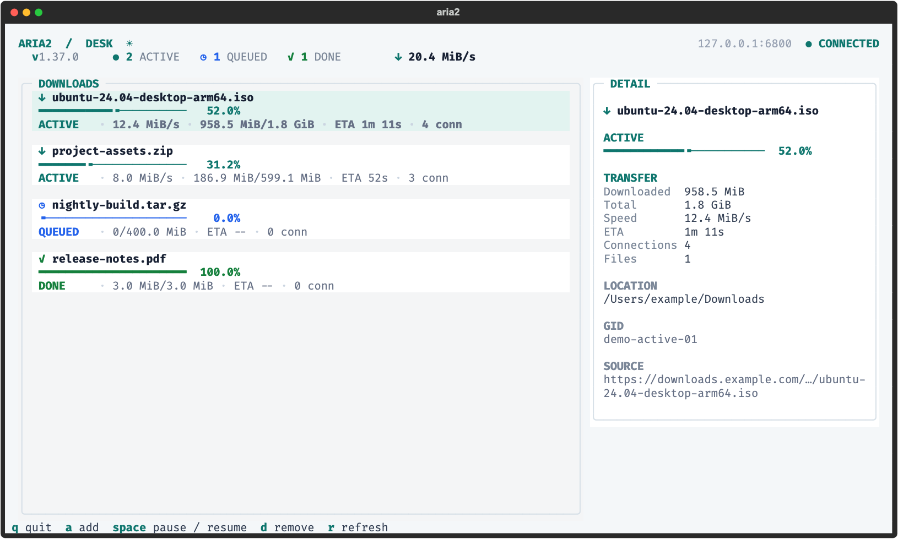

# aria2-tui

一个简约的 macOS 终端下载控制台，通过 aria2 JSON-RPC 管理本地下载。

| 深色模式 | 浅色模式 |
| --- | --- |
|  |  |

截图使用演示数据。

## 功能

- 实时显示下载进度、速度、剩余时间、连接数和文件大小
- 添加 HTTP/HTTPS、FTP、SFTP 与 magnet 任务
- 暂停、恢复、移除任务
- 自动发现 aria2 的默认下载目录
- 支持本地或远程 JSON-RPC，以及可选的 RPC 密钥
- 断线自动重连，任务列表每秒刷新
- 全键盘操作，支持较窄终端窗口
- 深色/浅色主题，根据终端背景色自动选择

## 运行

克隆并运行：

```bash
git clone https://github.com/zhyaqi/aria2-tui.git
cd aria2-tui
uv run aria2-tui
```

项目默认连接 `http://127.0.0.1:6800/jsonrpc`。也可以使用启动脚本：

```bash
./run.sh
```

作为全局工具安装：

```bash
uv tool install --editable .
aria2-tui
```

连接其他服务：

```bash
uv run aria2-tui --url http://127.0.0.1:6800/jsonrpc
```

使用 RPC 密钥：

```bash
export ARIA2_RPC_SECRET='your-secret'
uv run aria2-tui
```

也可以直接传参：

```bash
uv run aria2-tui --secret 'your-secret'
```

## 主题

默认使用自动模式，通过终端 OSC 11 查询背景色；如果终端不响应，则依次读取
`COLORFGBG` 和 macOS 系统外观，最后回退到深色模式。终端主题发生变化后，
重新启动应用即可重新检测。

手动指定主题：

```bash
uv run aria2-tui --theme light
uv run aria2-tui --theme dark
```

也可以通过环境变量设置：

```bash
export ARIA2_TUI_THEME=light
```

## 快捷键

| 按键 | 操作 |
| --- | --- |
| `a` | 添加下载 |
| `↑` / `↓` | 选择任务 |
| `Space` | 暂停或恢复 |
| `d` | 移除任务 |
| `r` | 立即刷新 |
| `q` | 退出 |

移除任务不会删除已经下载到磁盘的文件。已完成任务仅从 aria2 历史记录中移除。

## 开发

```bash
uv sync
uv run pytest -q
uvx ruff check src tests
uvx ruff format --check src tests
```

RPC 调用契约见 [docs/rpc-contract.md](docs/rpc-contract.md)。
